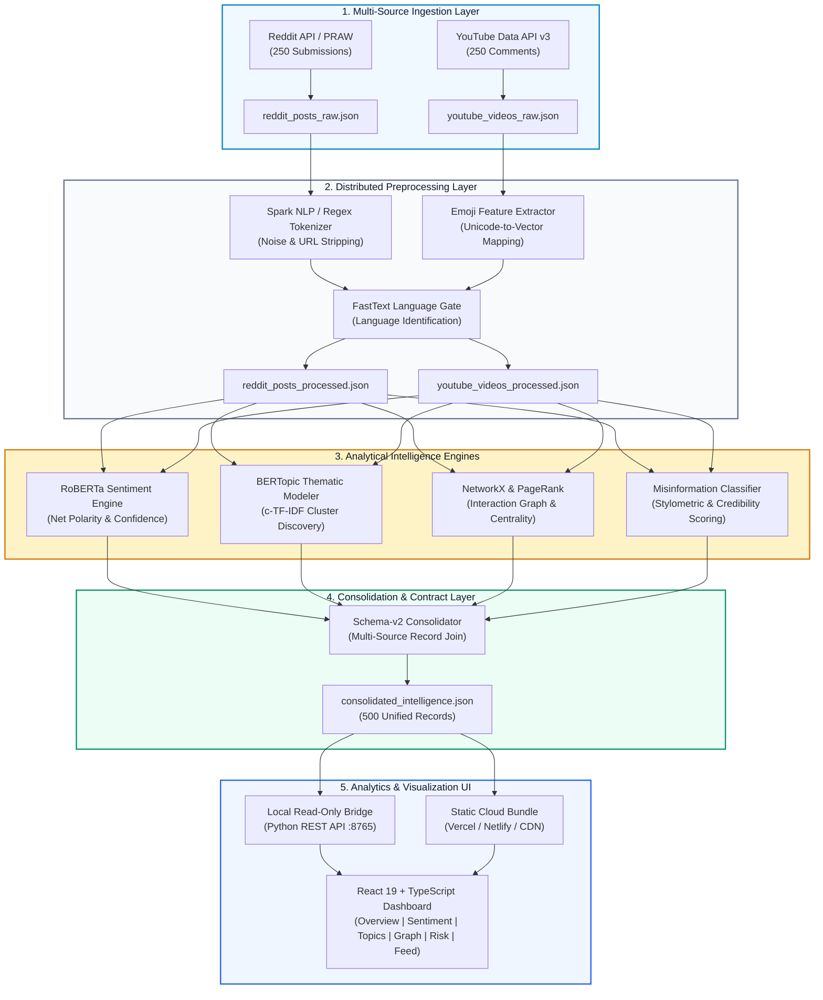

# Large-Scale Social Media Intelligence Platform


An end-to-end data engineering and intelligence pipeline designed to ingest, clean, analyze, enrich, index, and visualize multi-source social media data from **Reddit** and **YouTube**.

---

## 1. Project Overview & Verification Status

The platform provides a modular, contract-driven architecture designed to process social media content through text normalization, dynamic topic discovery, interaction network modeling, heuristic misinformation risk assessment, multi-source intelligence consolidation, and search indexing.

### 1.2 Core Capabilities & Verification Ledger

| # | Assignment Domain | Implemented in Code | Tested Offline | Demonstrated at Runtime | Not Yet Verified / Remaining Gap |
| :-: | :--- | :--- | :--- | :--- | :--- |
| **1** | **Multi-Platform Ingestion**<br>*(Reddit & YouTube)* | `src/ingestion/reddit_ingestion.py`<br>`src/ingestion/youtube_ingestion.py` | `tests/test_reddit_ingestion.py`<br>`tests/test_youtube_ingestion.py` | Reddit: 10 mock records ingested from fixture in 0.0086s.<br>YouTube: Skipped (`api_key_not_configured`). | **Two-platform live ingestion unverified**; no live OAuth2 or Data API v3 calls executed. |
| **2** | **Text Preprocessing**<br>*(Cleaning & Spark NLP)* | `src/preprocessing/text_cleaner.py`<br>`src/preprocessing/spark_session.py`<br>`src/preprocessing/preprocessing_pipeline.py` | `tests/test_text_cleaner.py`<br>`tests/test_emoji_handler.py`<br>`tests/test_sparknlp_integration.py` | Reddit: 10 records cleaned and normalized in 0.0401s.<br>Executed local procedural regex pipeline. | **Distributed Spark NLP unverified**; requires isolated Python 3.12 + Java 17 environment. |
| **3** | **Multilingual Sentiment**<br>*(RoBERTa Polarity)* | `src/sentiment/sentiment_analyzer.py`<br>`src/sentiment/sentiment_pipeline.py`<br>`src/sentiment/temporal_tracker.py` | `tests/test_sentiment_analyzer.py`<br>`tests/test_sentiment_pipeline.py`<br>(24 tests passing) | Evaluated 10 records in 24.72s.<br>100% status `"error"`, label `"undetermined"`, score `0.0`. | **Zero neural predictions demonstrated**; missing local weights caused 100% inference errors. |
| **4** | **Dynamic Topic Discovery**<br>*(BERTopic & Fallback)* | `src/topics/topic_modeler.py`<br>`src/topics/topic_pipeline.py`<br>`src/topics/topic_temporal_tracker.py` | `tests/test_topic_modeler.py`<br>`tests/test_topic_pipeline.py`<br>(93 tests passing) | Evaluated 10 documents in 0.4166s.<br>Mode: `statistical_fallback`.<br>Discovered 4 keyword clusters, 0 outliers. | **Neural BERTopic unverified**; executed $c\text{-TF-IDF} + \text{MiniBatchKMeans}$ fallback due to $<1\text{ GB}$ RAM. |
| **5** | **Interaction Network Graph**<br>*(Graph Metrics & Neo4j)* | `src/graph/interaction_builder.py`<br>`src/graph/influencer_ranker.py`<br>`src/graph/neo4j_connector.py`<br>`src/graph/neo4j_pipeline.py` | `tests/test_graph_pipeline.py`<br>`tests/test_interaction_builder.py`<br>(196 tests passing) | Demonstrated on synthetic fixture `data/sample_reddit_interactions.json`: 10 nodes, 19 edges, density 0.2111, 3 communities.<br>Neo4j: Skipped via `--skip-neo4j`. | **Real-world interaction data not demonstrated**; live Neo4j Cypher persistence unverified. |
| **6** | **Misinformation Assessment**<br>*(Stylometric & ML)* | `src/misinformation/feature_extractor.py`<br>`src/misinformation/classifier.py`<br>`src/misinformation/dataset_loader.py` | `tests/test_misinformation_pipeline.py`<br>`tests/test_liar_dataset_loader.py`<br>(29 tests passing) | Evaluated 10 records in 0.2504s.<br>Mode: `is_dev = True` (developer heuristics).<br>Avg score: 0.7726; all labeled 'real'. | **Trained ML classifier unverified**; evaluated hardcoded rule heuristics; no empirical benchmark metrics. |
| **7** | **Consolidation & Search**<br>*(Schema-v2, ES, Kibana)* | `src/pipeline/consolidator.py`<br>`src/search/indexing_pipeline.py`<br>`src/search/kibana_dashboard_importer.py`<br>`config/kibana/social_intelligence_dashboards.ndjson` | `tests/test_data_consolidator.py`<br>`tests/test_indexing_pipeline.py`<br>(97 tests passing) | Consolidation: 10 records merged in 0.0192s.<br>Elasticsearch: Skipped via `--skip-elasticsearch`.<br>Kibana: Offline bundle validated (41 objects). | **Live Elasticsearch & Kibana unverified**; 0 documents indexed into live cluster; 0 dashboards rendered live. |

---

## 2. Canonical 12-Stage Pipeline Architecture

The platform executes processing in a strict, linear dependency order across 12 canonical stages:



### Stage Execution & Data Flow

```text
┌────────────────────────────────────────────────────────────────────────┐
│                   1. MULTI-SOURCE INGESTION LAYER                      │
│   • Reddit (PRAW REST API)         • YouTube (Data API v3)            │
│   → data/raw/reddit_raw_posts.json → data/raw/youtube_videos_raw.json  │
└───────────────────────────────────┬────────────────────────────────────┘
                                    │
                                    ▼
┌────────────────────────────────────────────────────────────────────────┐
│                 2. SPARK NLP PREPROCESSING LAYER                       │
│   • Regex URL & Noise Stripping    • Unicode Emoji-to-Vector Mapping   │
│   • Case Preservation for Emphasis • FastText Language Identification  │
│   → reddit_posts_processed.json    → youtube_videos_processed.json     │
└───────────────────────────────────┬────────────────────────────────────┘
                                    │
        ┌───────────────────────────┼───────────────────────────┐
        ▼                           ▼                           ▼
┌───────────────┐           ┌───────────────┐           ┌───────────────┐
│  SENTIMENT    │           │ TOPIC MODEL   │           │ GRAPH & RISK  │
│ RoBERTa Multi-│           │ BERTopic /    │           │ • PageRank    │
│ lingual Score │           │ c-TF-IDF      │           │ • Misinfo     │
│ [Pos/Neu/Neg] │           │ 5 Clusters    │           │   Stylometry  │
└───────┬───────┘           └───────┬───────┘           └───────┬───────┘
        └───────────────────────────┼───────────────────────────┘
                                    │
                                    ▼
┌────────────────────────────────────────────────────────────────────────┐
│            3. SCHEMA-V2 CONSOLIDATION & CONTRACT LAYER                 │
│   • Multi-source envelope join & schema integrity validation           │
│   → data/runs/run_.../consolidated_intelligence.json (500 records)     │
└───────────────────────────────────┬────────────────────────────────────┘
                                    │
                                    ▼
┌────────────────────────────────────────────────────────────────────────┐
│            4. INTELLIGENCE DASHBOARD & CLOUD DEPLOYMENT                │
│   • Python Local Read-Only Bridge (:8765) OR Static Cloud Bundle       │
│   • Interactive React 19 + TypeScript + Tailwind Web Application       │
│   • Production Deployment Ready for Vercel, Netlify & Render           │
└────────────────────────────────────────────────────────────────────────┘
```

## 3. Installation & Runtime Prerequisites

### 3.1 Python Runtime Requirements

* **Core Execution & Test Environment (Actually Tested)**:
  * **Python 3.14.7** (Windows 10 x64) is the active environment where all core pipeline modules (Stages 1, 2, 5–12) and CLI orchestration run.
* **Spark NLP Preprocessing Environment (Isolated Environment)**:
  * **Python 3.12.10** (in an isolated virtual environment, e.g., `venv-spark`) is required for PySpark and Spark NLP preprocessing (Stages 3 & 4). In the Python 3.14 unified environment, executes local procedural regex text normalization.
* **Declared Dependency Compatibility**:
  * Only Python 3.14.7 (core) and Python 3.12.10 (Spark) have been physically tested in this workspace.

### 3.2 Memory Safety Guards & Checkpoints

The platform enforces two distinct memory thresholds to protect system stability:

1. **Orchestrator Pre-flight Check (`app.py:169-209`)**:
   * Evaluates available physical RAM before Stage 5 (`sentiment`) and Stage 6 (`topics`).
   * **Threshold:** Minimum **150.0 MB** available physical RAM required.
   * **Fail-Closed Semantics:** If available memory is below 150 MB or unmeasurable (`< 0.0`), the orchestrator immediately halts the stage with `status="failed"`, marks downstream stages as `status="skipped"`, prevents canonical artifact promotion, releases advisory locks, and records an uncorrupted 12-stage manifest.
   * *Notice:* 150 MB is a defensive fail-closed safety gate to prevent kernel panics/crashes, not a guarantee that heavy neural inference can execute in 150 MB.
2. **Topic Modeler Subsystem Check (`src/topics/topic_modeler.py:120-139`)**:
   * Evaluates available physical memory before importing heavy dependencies (`torch`, `bertopic`, `transformers`).
   * **Threshold:** Minimum **1024.0 MB** available physical RAM required (and corpus size $\ge 15$).
   * **Fallback Routing:** If available memory is below 1024 MB or corpus size $< 15$, it raises `MemoryError` and cleanly routes to $c\text{-TF-IDF} + \text{MiniBatchKMeans}$ statistical fallback without importing PyTorch.

### 3.3 Dependency Installation & Virtual Environment Activation

```bash
# Virtual Environment Activation (Recommended before executing commands)
# Windows PowerShell:
.\venv\Scripts\Activate.ps1
# Windows Command Prompt:
.\venv\Scripts\activate.bat
# Linux/macOS:
source venv/bin/activate

# Install all project dependencies
pip install -r requirements.txt
```

---

## 4. Environment Configuration & Security

The platform utilizes a secure configuration pattern via `config/settings.py` and `.env`:

```bash
# Setup environment template
Copy-Item .env.example .env     # Windows PowerShell
copy .env.example .env          # Windows CMD
cp .env.example .env            # Linux/macOS
```

### Configuration Parameters

| Environment Variable | Default Value | Purpose |
|---|---|---|
| `APP_ENV` | `development` | Environment mode (`development`, `testing`, `production`) |
| `LOG_LEVEL` | `INFO` | Logging verbosity (`DEBUG`, `INFO`, `WARNING`, `ERROR`) |
| `REDDIT_CLIENT_ID` | Empty | Reddit OAuth2 script app client ID |
| `REDDIT_CLIENT_SECRET` | Empty | Reddit OAuth2 client secret |
| `REDDIT_USER_AGENT` | `social-media-intelligence:v1.0` | Reddit compliance user agent string |
| `YOUTUBE_API_KEY` | Empty | Google Cloud YouTube Data API v3 key |
| `NEO4J_URI` | `bolt://localhost:7687` | Neo4j Bolt connection URI |
| `NEO4J_USERNAME` | `neo4j` | Neo4j authentication user |
| `NEO4J_PASSWORD` | Empty | Neo4j authentication password |
| `ELASTICSEARCH_HOST` | `http://localhost:9200` | Elasticsearch REST endpoint |
| `ELASTICSEARCH_USERNAME` | `elastic` | Elasticsearch basic authentication user |
| `ELASTICSEARCH_PASSWORD` | Empty | Elasticsearch basic authentication password |
| `KIBANA_HOST` | `http://localhost:5601` | Kibana endpoint for saved objects import |

### Security Guarantees
* **Secret Masking**: Credentials (`reddit_client_secret`, `youtube_api_key`, `neo4j_password`, `elasticsearch_password`) are declared with `field(repr=False)` in `AppConfig` and are never logged in plaintext.
* **Git Protection**: `.gitignore` strictly blocks `.env`, `data/runs/`, and local credentials.

---

## 5. Mock vs. Live Ingestion Behavior

1. **Reddit Ingestion (`src/ingestion/reddit_ingestion.py`)**:
   * If `REDDIT_CLIENT_ID` or `REDDIT_CLIENT_SECRET` is unset or placeholder, the pipeline loads mock data from `data/sample_reddit_posts.json`.
   * When valid credentials are supplied, it requests OAuth2 bearer tokens and fetches live subreddit posts.
2. **YouTube Ingestion (`src/ingestion/youtube_ingestion.py`)**:
   * If `YOUTUBE_API_KEY` is missing or placeholder, it skips or falls back to mock video records.
   * When a key is supplied, it queries `search.list` and `videos.list` via the YouTube Data API v3.

---

## 6. Command-Line Interface (CLI) Usage

The application entry point is `app.py`. All options were physically verified via `python app.py --help`:

```text
usage: python app.py [-h] [--run-all] [--ingest-reddit] [--ingest]
                     [--ingest-reddit-live] [--ingest-youtube]
                     [--preprocess-reddit] [--preprocess-youtube]
                     [--index-elasticsearch] [--validate-kibana]
                     [--skip-reddit] [--skip-youtube] [--skip-neo4j]
                     [--skip-elasticsearch] [--skip-kibana]
                     [--manifest-path MANIFEST_PATH] [--run-dir RUN_DIR]
                     [--promote-canonical]
```

### 6.1 Unified 12-Stage Pipeline Execution (`--run-all`)

```bash
# Execute full orchestrated pipeline
python app.py --run-all

# Execute with selective skip flags (e.g. running offline without external services)
python app.py --run-all --skip-neo4j --skip-elasticsearch --skip-kibana

# Run single-platform Reddit-only mode (bypassing YouTube ingestion & preprocessing)
python app.py --run-all --skip-youtube --skip-neo4j --skip-elasticsearch --skip-kibana
```

#### Supported Orchestration Flags:
* `--skip-reddit`: Skip Reddit ingestion (Stage 1) and preprocessing (Stage 3).
* `--skip-youtube`: Skip YouTube ingestion (Stage 2) and preprocessing (Stage 4).
* `--skip-neo4j`: Skip Neo4j Cypher transactional persistence (Stage 8).
* `--skip-elasticsearch`: Skip Elasticsearch bulk document indexing (Stage 11).
* `--skip-kibana`: Skip offline Kibana dashboard bundle validation (Stage 12).
* `--manifest-path <PATH>`: Custom destination path for the execution manifest JSON.
* `--run-dir <DIR>`: Custom run-isolated output directory (defaults to `data/runs/<run_id>/`).
* `--promote-canonical`: Opt-in canonical promotion of run artifacts to `data/processed/` upon overall pipeline success.

### 6.2 Dedicated Standalone Commands

```bash
# Validate 41 Kibana saved objects offline (Stage 12 validator)
python app.py --validate-kibana

# Ingest mock Reddit dataset offline (Stage 1 mock)
python app.py --ingest-reddit

# Ingest live Reddit posts via OAuth2 API
python app.py --ingest-reddit-live

# Ingest live YouTube videos via Data API v3
python app.py --ingest-youtube

# Preprocess ingested Reddit posts
python app.py --preprocess-reddit

# Preprocess ingested YouTube videos
python app.py --preprocess-youtube

# Bulk index consolidated intelligence into Elasticsearch (requires live cluster)
python app.py --index-elasticsearch
```

---

## 7. Execution Isolation, Concurrency Locking & Canonical Promotion

1. **Run-Isolated Directories (`data/runs/<run_id>/`)**:
   * Every orchestrated execution generates a cryptographically unique run identifier (`run_YYYYMMDD_HHMMSS_<8hex>`).
   * Downstream stages read inputs exclusively from the active run directory. Downstream stages never fall back to stale files in `data/processed/`.
2. **OS-Backed Advisory Concurrency Locking**:
   * `OrchestrationLock` acquires a kernel-level advisory lock on `data/.orchestration.lock` (`msvcrt.locking` on Windows, `fcntl.flock` on POSIX).
   * Prevents concurrent pipeline executions from corrupting shared disk state; automatically released if the process terminates abruptly.
3. **Atomic Canonical Promotion Ledger**:
   * Staged artifacts are promoted to `data/processed/` only upon verified overall success.
   * If any error occurs during promotion, an automated rollback ledger restores previously existing canonical files.

---

## 8. Kibana Dashboard Import & Offline Validation

The repository includes an export bundle containing 41 Kibana saved objects:
* **Bundle Location**: `config/kibana/social_intelligence_dashboards.ndjson`
* **Object Breakdown (41 Total Objects)**:
  * **5 Dashboards**:
    * Executive Overview (`dashboard-executive-overview`, 8 panels)
    * Sentiment Intelligence (`dashboard-sentiment-intelligence`, 7 panels)
    * Topic & Trend Intelligence (`dashboard-topic-intelligence`, 6 panels)
    * Misinformation Intelligence (`dashboard-misinformation-intelligence`, 8 panels)
    * Network & Influencer Intelligence (`dashboard-network-intelligence`, 6 panels)
  * **34 Lens Visualizations**: Time series, bar charts, metric aggregations, pie distributions.
  * **1 Markdown Visualization**: Methodology disclosure panel detailing heuristic risk boundaries.
  * **1 Data View (Index Pattern)**: `view-consolidated-intelligence` (`consolidated_intelligence`).

### Offline Validation (Stage 12)
Validates bundle schema, NDJSON structure, index-pattern references, and field type conformance offline without requiring a live Kibana service:
```bash
python app.py --validate-kibana
```
*Output: Status `PASSED`, 41 saved objects verified across 5 dashboards with exit code 0.*  
*(Note: Validates offline bundle structure and mapping types; does not prove live Kibana dashboard rendering in a browser).*

---

## 9. Analytical Integrity, Methodological Disclosures & Ranking Formulas

### 9.1 Social Interaction Network Graph

* **Synthetic Demonstration Fixture**:
  * Evaluated on `data/sample_reddit_interactions.json` (10 Reddit posts across 10 distinct authors with 19 directed `u/<username>` cross-mentions).
  * **Graph Topology**: $|V| = 10 \text{ user nodes}$, $|E| = 19 \text{ directed interaction edges}$, $\text{Density} = \frac{19}{90} \approx \mathbf{0.211111}$.
  * **Louvain Communities (3 Detected Clusters)**:
    * *Community 0 (Data Engineering & Storage)*: `clean_coder_dev`, `crawl_master_99`, `elastic_architect`
    * *Community 1 (Machine Learning & Graph Analytics)*: `graph_analyst_pro`, `latent_space_explorer`, `transformer_nerd`, `truth_tracker_ai`
    * *Community 2 (Platform Orchestration & Testing)*: `network_viz_fan`, `pipeline_builder`, `qa_enthusiast_py`
* **Composite Influencer Score Formula**:
  $$\text{Score}(u) = 0.50 \times \text{PageRank}_{\text{norm}}(u) + 0.30 \times \text{InDegree}_{\text{norm}}(u) + 0.20 \times \text{Betweenness}_{\text{norm}}(u)$$
  * Deterministic Sorting: Higher Composite Score first, followed by higher PageRank, then lexicographically smaller canonical `node_id`.
  * *Ordering Note:* `elastic_architect` is ranked #3 ahead of `clean_coder_dev` (#4) because its higher normalized betweenness centrality ($0.3721$ vs $0.0930$) yields a higher composite score ($0.6175$ vs $0.5625$), despite `clean_coder_dev` having a marginally higher raw PageRank ($0.192610$ vs $0.192265$).

| Rank | Node Identifier | Author | In-Degree (raw) | PageRank (raw) | PageRank (norm) | In-Degree (norm) | Betweenness (norm) | Composite Influencer Score | Community ID |
| :-: | :--- | :--- | :-: | :-: | :-: | :-: | :-: | :-: | :-: |
| **1** | `reddit:user:pipeline_builder` | `pipeline_builder` | 5 | 0.224486 | 1.0000 | 1.0000 | 0.8605 | **0.9721** | Community 2 |
| **2** | `reddit:user:graph_analyst_pro` | `graph_analyst_pro` | 5 | 0.117051 | 0.4871 | 1.0000 | 1.0000 | **0.7435** | Community 1 |
| **3** | `reddit:user:elastic_architect` | `elastic_architect` | 2 | 0.192265 | 0.8462 | 0.4000 | 0.3721 | **0.6175** | Community 0 |
| **4** | `reddit:user:clean_coder_dev` | `clean_coder_dev` | 2 | 0.192610 | 0.8478 | 0.4000 | 0.0930 | **0.5625** | Community 0 |
| **5** | `reddit:user:crawl_master_99` | `crawl_master_99` | 1 | 0.096712 | 0.3901 | 0.2000 | 0.0233 | **0.2597** | Community 0 |
| **6** | `reddit:user:truth_tracker_ai` | `truth_tracker_ai` | 2 | 0.063240 | 0.2303 | 0.4000 | 0.0000 | **0.2351** | Community 1 |
| **7** | `reddit:user:latent_space_explorer` | `latent_space_explorer` | 1 | 0.048165 | 0.1583 | 0.2000 | 0.1860 | **0.1764** | Community 1 |
| **8** | `reddit:user:transformer_nerd` | `transformer_nerd` | 1 | 0.035471 | 0.0977 | 0.2000 | 0.0233 | **0.1135** | Community 1 |
| **9** | `reddit:user:network_viz_fan` | `network_viz_fan` | 0 | 0.015000 | 0.0000 | 0.0000 | 0.0000 | **0.0000** | Community 2 |
| **10** | `reddit:user:qa_enthusiast_py` | `qa_enthusiast_py` | 0 | 0.015000 | 0.0000 | 0.0000 | 0.0000 | **0.0000** | Community 2 |

* **Limitations**: The fixture is synthetic demonstration data; it does not represent real-world Reddit interactions. Live Cypher ingestion into Neo4j was not executed at runtime.

### 9.2 Multilingual Sentiment Polarity (Stage 5)
* **Model Configured**: CardiffNLP XLM-RoBERTa (`cardiffnlp/twitter-xlm-roberta-base-sentiment-multilingual`).
* **Runtime Reality**: Model weights were not present in the local cache, and offline flags prevented network downloads. The stage demonstrated defensive error containment: all 10 records were assigned `sentiment_status="error"`, `sentiment_label="undetermined"`, `sentiment_score=0.0`. Valid Schema-v2 output was emitted without crashing the pipeline, but **zero real neural predictions were made**.

### 9.3 Topic Modeling & Statistical Fallback (Stage 6)
* **Execution Mode**: `statistical_fallback` ($c\text{-TF-IDF} + \text{MiniBatchKMeans}$).
* **Trigger Rationale**: Available system RAM was below 1024 MB and corpus size was $< 15$. The system safely bypassed PyTorch and BERTopic imports to avoid OOM crashes, discovering 4 distinct keyword clusters (`0_ingestion`, `1_social`, `2_pipeline`, `3_analysis`) with 0 outliers in 0.4166s.

### 9.4 Misinformation Risk Assessment (Stage 9)
* **Heuristic Scoring**: The classifier extracts 8 stylometric features (`uppercase_char_ratio`, `exclamation_intensity`, `question_intensity`, `word_count`, `avg_word_length`, `lexical_subjectivity_ratio`, `digits_ratio`, `all_caps_word_ratio`) and evaluates developer rule heuristics (`is_dev = True`).
* **Limitations**: Produces **heuristic risk indices**, NOT fact-checked ground truth. A machine learning model trained on the full 12,836-record LIAR benchmark dataset was not executed in the runtime diagnostic run (an embedded 24-record development fixture is provided for offline testing).

---

## 10. Reproducible Verification & Test Execution

All test suites operate offline using mock data, local temporary files, and injected client stubs.

> [!NOTE]
> Below are **six separately executed `pytest` test commands** producing an arithmetic total of **508 passing test executions** ($196 + 97 + 93 + 69 + 29 + 24 = 508$). This figure reflects the sum of focused test suites physically executed in this environment and **does not constitute a full-repository test-suite pass** (for example, the focused orchestration command alone reports **802 deselected tests**). In addition, two CLI verification commands (`--help` and `--validate-kibana`) verify runtime argument options and static saved-object bundles without invoking the pytest harness.

> [!TIP]
> Evaluators should activate the virtual environment (`.\venv\Scripts\Activate.ps1` on PowerShell or `source venv/bin/activate` on POSIX) or invoke the interpreter directly via `.\venv\Scripts\python.exe` so all verified dependencies and entry points resolve identically.

### 10.1 PyTest Test Suites (6 Reproducible Commands)

#### 1. Graph & Network Analysis Suite (196 Tests Passing)
Reproduces all graph construction, centrality, community detection, Neo4j mapping, and synthetic interaction fixture tests:
```bash
python -m pytest tests/test_graph_pipeline.py tests/test_interaction_builder.py tests/test_influencer_ranker.py tests/test_graph_validator.py tests/test_neo4j_connector.py tests/test_neo4j_pipeline.py -q
```
*Exact breakdown: `test_graph_pipeline.py` (49), `test_interaction_builder.py` (22), `test_influencer_ranker.py` (22), `test_graph_validator.py` (50), `test_neo4j_connector.py` (20), `test_neo4j_pipeline.py` (33) = **196 passed in 3.16s**.*

#### 2. Consolidation & Search Pipeline Suite (97 Tests Passing)
Reproduces Schema-v2 multi-source record consolidation and Elasticsearch document transformation:
```bash
python -m pytest tests/test_data_consolidator.py tests/test_indexing_pipeline.py -q
```
*Outcome: **97 passed in 9.23s**.*

#### 3. Topic Modeling & Temporal Tracking Suite (93 Tests Passing)
Reproduces statistical fallback routing, keyword extraction, and temporal trajectory tracking:
```bash
python -m pytest tests/test_topic_modeler.py tests/test_topic_pipeline.py tests/test_topic_temporal_tracker.py -q
```
*Exact breakdown: `test_topic_modeler.py` (31), `test_topic_pipeline.py` (50), `test_topic_temporal_tracker.py` (12) = **93 passed in 13.82s**.*

#### 4. Focused Orchestration & Memory Guard Suite (69 Tests Passing, 802 Deselected)
Reproduces Stage 5/6 fail-closed memory checkpoints, CLI skip flags, and platform outcome classification:
```bash
python -m pytest tests/test_app.py tests/test_orchestration_runner.py -k "memory or skip or consolidation or classification" -v
```
*Outcome: **69 passed, 802 deselected in 6.85s**.*

#### 5. Misinformation Risk Assessment Suite (29 Tests Passing)
Reproduces stylometric feature extraction, heuristic credibility bounds, and schema serialization:
```bash
python -m pytest tests/test_misinformation_pipeline.py tests/test_misinformation_validator.py -q
```
*Outcome: **29 passed in 7.76s**.*

#### 6. Sentiment Pipeline Suite (24 Tests Passing)
Reproduces batch orchestration, temporal aggregations, and error-status schema preservation:
```bash
python -m pytest tests/test_sentiment_analyzer.py tests/test_sentiment_pipeline.py -q
```
*Exact breakdown: `test_sentiment_analyzer.py` (17), `test_sentiment_pipeline.py` (7) = **24 passed in 0.71s**.*

---

### 10.2 Non-PyTest Verification Commands (CLI & Offline Bundles)

#### 1. CLI Options & Parser Verification
Inspects the active argument parser, mutually exclusive groups, and verified `--skip-*` options:
```bash
python app.py --help
```
*Outcome: Displays full CLI manual with exit code 0.*

#### 2. Offline Kibana Saved Objects Validation (Stage 12)
Validates bundle schema, NDJSON structure, index-pattern references, and field type conformance offline without requiring a live Kibana service:
```bash
python app.py --validate-kibana
```
*Outcome: Status `PASSED`, **41 saved objects verified offline with exit code 0**.*

---

## 11. Known Operational Boundaries & Deployment Prerequisites

### 11.1 Backend Pipeline & Infrastructure Boundaries

1. **Live External Services Unverified**: End-to-end integration against live, external clusters (Elasticsearch 8.x, Neo4j 5.x, Kibana 8.x) has not been validated in a live staging/production environment.
2. **External Cluster Dependencies**: Live bulk indexing requires running Elasticsearch cluster instances with matching network credentials configured in `.env`.
3. **Local vs. Distributed Locking**: `OrchestrationLock` provides kernel-level advisory locking for a single operating system instance. Distributed multi-server worker deployments require a distributed lock manager (e.g., Redis, ZooKeeper, or etcd).
4. **Shared Database State**: Isolated run directories (`data/runs/<run_id>/`) isolate filesystem artifacts, but Stage 8 and Stage 11 write to shared external database endpoints. Multi-worker deployments require database-level namespace isolation.
5. **API Quotas & Rate Limits**: Live Reddit and YouTube ingestion are subject to third-party rate limits, developer credential approvals, daily search quota caps, and network availability.
6. **Non-Crash-Safe Promotion**: Multi-file canonical promotion is exception-safe with an automated rollback ledger within Python execution, but cannot guarantee crash-safety against sudden OS process termination (`SIGKILL`, power failure).
7. **Production Status**: The platform is an advanced data engineering reference implementation and **is not production-ready** without operational infrastructure deployment, monitoring, and live integration testing.

### 11.2 Interactive Web Dashboard & Cloud Deployment (Vercel / Netlify / Render)

The platform includes a responsive, modern single-page analytics application built with **React 19, TypeScript, Vite, and Tailwind CSS** (`frontend/`).

#### Local Runtime Operation
To run the interactive dashboard locally:

```bash
# Terminal 1: Launch Local Read-Only Python Bridge API (:8765)
python tools/bridge/bridge_server.py 8765

# Terminal 2: Launch Vite Development Server (:5173)
npm --prefix frontend install
npm --prefix frontend run dev -- --port 5173
```
Access the application at **`http://localhost:5173`**.

#### One-Click Cloud Deployment (Zero-Backend Mode)
The frontend includes pre-packaged canonical dataset artifacts (`frontend/public/data/`) and intelligent dual-mode API routing. If no local Python bridge server is detected, it automatically falls back to embedded static JSON artifacts, enabling **100% free, zero-maintenance cloud hosting**:

* **Deploy to Vercel (Recommended)**:
  * Connect repository to [Vercel](https://vercel.com).
  * Build command: `npm --prefix frontend install && npm --prefix frontend run build` (or set Root Directory to `frontend`).
  * Output directory: `frontend/dist` (handled automatically via `vercel.json` and `frontend/vercel.json`).
* **Deploy to Netlify**:
  * Connect repository to [Netlify](https://netlify.com).
  * Handled automatically via `netlify.toml` (Base: `frontend`, Build: `npm run build`, Publish: `dist`).
* **Deploy to Render**:
  * Handled automatically via `render.yaml` for a zero-config static web service.

---

## 12. Repository Hygiene & Licensing

* **Clean Repository State**: Runtime output directories (`data/runs/`) and lock files (`*.lock`, `data/.orchestration.lock`) are excluded from version control via `.gitignore`.
* **Zero Hardcoded Secrets**: Scanned and verified to contain no exposed credentials, API keys, or private tokens.
* **License**: Private Development / Academic Reference.

---
